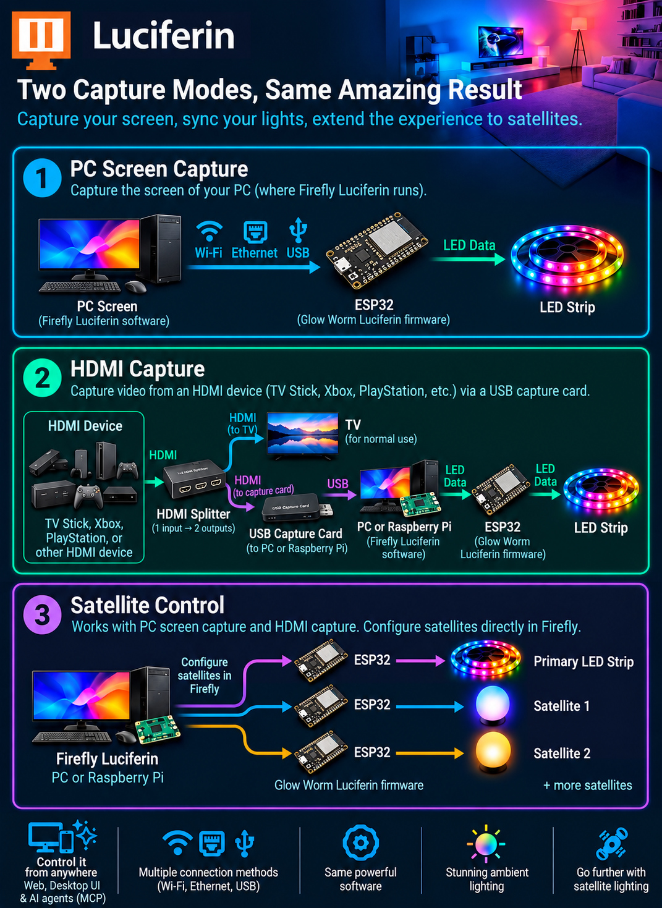

# *Luciferin v3.0 is here!*

### Here’s what’s new in this major release.

> [!IMPORTANT]
> This release requires **Glow Worm Luciferin firmware v6.0.0**.
> Install it from your browser with the **[Glow Worm Luciferin Web Installer](https://sblantipodi.github.io/glow_worm_luciferin/)**.
> If you are upgrading from a previous version, the **[automatic update feature](https://github.com/sblantipodi/toremove/wiki/Luciferin-update-management)** can update both the PC software and the firmware.
> Step-by-step instructions are in the **[installation guide](https://github.com/sblantipodi/toremove/wiki/Installers-and-binaries)**.

## Highlights

* Control Luciferin in natural language from your preferred AI agent via **[MCP](https://github.com/sblantipodi/toremove/wiki/MCP-and-AI-Agents)**.
* **[Capture from USB HDMI devices](https://github.com/sblantipodi/toremove/wiki/Quick-start)**: Xbox, PlayStation, TV sticks and virtually any HDMI source.
* New **[web interface](https://github.com/sblantipodi/toremove/wiki/Remote-Access#firefly-luciferin-web-interface)** for remote control and headless setups, including compact standalone ambient lighting systems based on  **[Raspberry Pi](https://github.com/sblantipodi/toremove/wiki/Compatible-Hardware#raspberry-pi)**.
* **[Adaptive gamma](https://github.com/sblantipodi/toremove/wiki/Color-Temperature-and-White-Balance#adaptive-gamma-correction)** and **[HDR to SDR tone mapping](https://github.com/sblantipodi/toremove/wiki/HDR-to-SDR-and-LUT)** for much better color accuracy.
* [**32-bit floating-point color processing and frame interpolation**](https://github.com/sblantipodi/toremove/wiki/Color-Grading-(Hue-Saturation-and-Lightness-tuning)#advanced-rendering-pipeline) replace 8-bit integer processing for smoother color fades and better contrast.
* **[Lossless RLE compression](https://github.com/sblantipodi/toremove/wiki/Lossless-compression-and-overlay)** and **[LED grouping compression](https://github.com/sblantipodi/toremove/wiki/Group-LEDs)** for lower latency.
* Added [**Matter over WiFi**](https://github.com/sblantipodi/toremove/wiki/Home-Automation-configs#matter-pairing) support, enabling integration with Google Home, Alexa, Apple Home, and other Matter compatible platforms.
* On Linux, **[adds native ARM64 support](https://github.com/sblantipodi/toremove/wiki/Linux-support)** and **[improved GPU hardware acceleration](https://github.com/sblantipodi/toremove/wiki/Linux-support#wayland-support-and-hardware-acceleration)**.

## New features

### Capture and control

* **[Capture anything, anywhere](https://github.com/sblantipodi/toremove/wiki/Quick-start)**: Luciferin stays PC first, but can now capture video from USB HDMI capture devices, bringing ambient lighting to Xbox, PlayStation, TV sticks and virtually any HDMI source. Combined with Raspberry Pi support and headless mode, it can run next to your TV with no PC or desktop environment.
* Added a **[web interface](https://github.com/sblantipodi/toremove/wiki/Remote-Access#firefly-luciferin-web-interface)** for Firefly Luciferin, allowing convenient control from a smartphone. Ideal for headless setups such as a Raspberry Pi connected to a TV, where no keyboard, mouse, or monitor is available. The Glow Worm web interface remains available for standalone LED control when bias lighting is not in use.
* Control Luciferin in natural language from your preferred AI agent via the **[Model Context Protocol (MCP)](https://github.com/sblantipodi/toremove/wiki/MCP-and-AI-Agents)**.
* Enable the optional **[overlay](https://github.com/sblantipodi/toremove/wiki/Lossless-compression-and-overlay)** from **[Test Image](https://github.com/sblantipodi/toremove/wiki/Test-image-and-latency-test)** to see exactly what is being sent to the LEDs in real time. The overlay also shows which lossless compression is in use, the capture frame rate, and how dynamic range is handled.

### Color processing

* **[Adaptive gamma](https://github.com/sblantipodi/toremove/wiki/Color-Temperature-and-White-Balance#adaptive-gamma-correction)**: automatically adjusts color brightness based on how dark or bright the scene is, making dark areas clearer without washing out bright ones and significantly improving color accuracy in low light scenes. HDR content benefits even more, thanks to a stronger adaptive profile that enhances color accuracy across wide dynamic ranges.
  * Smooth transition between adaptive (dark scenes) and classic (bright scenes) modes using a smoothstep function, avoiding abrupt changes.
  * More aggressive adaptive profile in HDR mode, greatly improving color rendering on content with wide dynamic range.
  * Per-frame average brightness tracking with dead zone filtering, to avoid flickering on static or borderline scenes.
  * New `sensor.luciferin_adaptive_gamma` entity to monitor the current gamma in **[Home Assistant](https://github.com/sblantipodi/toremove/wiki/Home-Automation-configs)**.
* **[HDR to SDR tone mapping](https://github.com/sblantipodi/toremove/wiki/HDR-to-SDR-and-LUT)** with configurable color balance and enhancement, plus custom 3D LUTs in `.cube` format. Closes **[#313](https://github.com/sblantipodi/firefly_luciferin/issues/313)**.
* **[32-bit floating-point pipeline](https://github.com/sblantipodi/toremove/wiki/Color-Grading-(Hue-Saturation-and-Lightness-tuning)#advanced-rendering-pipeline)**: color processing and frame interpolation now use 32-bit floats instead of 8-bit integers. This avoids intermediate rounding to 8 bits, yielding smoother color fades, better contrast in dark scenes, and fewer visible rounding artifacts.
* Smoother transitions: improved **[EMA](https://github.com/sblantipodi/toremove/wiki/Smoothing-color-transitions#exponential-moving-average-ema)** and **[frame generation](https://github.com/sblantipodi/toremove/wiki/Smoothing-color-transitions#multi-frame-generation-using-linear-interpolation)** through continuous updates and steady pacing.

### Performance and protocol

* **[Lossless RLE compression](https://github.com/sblantipodi/toremove/wiki/Lossless-compression-and-overlay)** uses run-length encoding for LED frames, reducing bandwidth and latency, especially on setups with high LED counts.
* **[LED grouping compression](https://github.com/sblantipodi/toremove/wiki/Group-LEDs)**: only the minimal set of color values is sent (100 LEDs with group size 2 send 50 values) and the microcontroller expands them locally for optimal efficiency and latency.
* Automatic [**SIMD micro benchmark**](https://github.com/sblantipodi/toremove/wiki/Very-fast-capture#cpu-acceleration-using-avx-simd-extensions): a transparent mini benchmark evaluates two SIMD strategies and selects the fastest one with a runtime CPU specific calibration, for optimal frame processing performance.
* [**Frame generation**](https://github.com/sblantipodi/toremove/wiki/Smoothing-color-transitions) now runs on a dedicated worker thread, so it no longer blocks the video callback used for capture and live preview.
* UDP traffic class adjusted to avoid routers that block or mishandle Expedited Forwarding, improving reliability on problematic networks.
* [**Ethernet**](https://github.com/sblantipodi/toremove/wiki/Compatible-Hardware#ethernet-devices) via W5500 is significantly faster, thanks to **[PR #12856](https://github.com/espressif/arduino-esp32/pull/12856)**.

### Hardware and firmware

* Added support for ESP32-C5 and ESP32-S31. See **[compatible hardware](https://github.com/sblantipodi/toremove/wiki/Compatible-Hardware)**.
* [**Matter support**](https://github.com/sblantipodi/toremove/wiki/Home-Automation-configs#matter-pairing) is now available on devices with at least 8 MB of flash memory, allowing them to be exposed as lights to Alexa, Google Home, and other Matter-compatible ecosystems.
* **[Web Installer](https://sblantipodi.github.io/glow_worm_luciferin)** improvements, thanks to @balloob for **[#102](https://github.com/sblantipodi/glow_worm_luciferin/pull/102)**:
  * Wi-Fi network scan with a picker.
  * Firefox is now supported.
* ESP temperature is now shown in the [**web interface**](https://github.com/sblantipodi/toremove/wiki/Remote-Access#glow-worm-luciferin-web-interface).
* Upgraded to Arduino Core 4.
* **[Arduino Bootstrapper](https://github.com/sblantipodi/arduino_bootstrapper/releases)** updated to v1.20.1.
* Firefly Luciferin now detects the baud rate of the selected serial device and logs each attempt. If the detected rate differs from the saved setting, it updates the active profile and shows a warning.
 
### Linux

* **[Native Linux ARM64 support](https://github.com/sblantipodi/toremove/wiki/Linux-support)**, bringing optimized performance to ARM based systems.
* **[NVIDIA, AMD and Intel optimizations](https://github.com/sblantipodi/toremove/wiki/Linux-support#luciferin-supports-wayland)** with GPU native buffer processing: video frames stay in GPU memory, avoiding unnecessary GPU to CPU transfers. Significantly higher performance and dramatically reduced processing latency, even on small devices such as a Raspberry Pi.
* **[Flatpak](https://flathub.org/en/apps/org.dpsoftware.FireflyLuciferin)**: NVIDIA CUDA toolkit updated to 13.3.
* **[Flatpak](https://flathub.org/en/apps/org.dpsoftware.FireflyLuciferin)**: AMD ROCm HIP SDK updated to 7.2.4.
* **[Snap](https://snapcraft.io/fireflyluciferin)**: update to Core 26.

### User interface

* New Modern Orange and Modern Artic **[themes](https://github.com/sblantipodi/toremove/wiki/Themes)** for the desktop user interface.
* Added a new dark theme for the [**Glow Worm firmware web interface**](https://github.com/sblantipodi/toremove/wiki/Remote-Access#glow-worm-luciferin-web-interface).
* Cleaner and more intuitive layout: baud rate and output device settings moved to the Devices tab, and the system tray icon gives quick access to the web interface.
* Replaced legacy Windows tray balloon notifications with native WinRT Toast notifications (via Java FFM) so notifications persist in the Windows Action Center.

## Improvements

* [**Smoothing Level 3**](https://github.com/sblantipodi/toremove/wiki/Smoothing-color-transitions) is now the default and can be changed at any time.
* Refactored **[black bars detection](https://github.com/sblantipodi/toremove/wiki/Aspect-ratio)**, with debouncing to prevent flickering on automatic aspect ratio changes.
* Improved [**LED grouping**](https://github.com/sblantipodi/toremove/wiki/Group-LEDs) accuracy: uneven and odd/even boundary regions are now handled correctly, for a more consistent color distribution across the strip.

## Bug fixes

* **[Tile resize](https://github.com/sblantipodi/toremove/wiki/Test-image-and-latency-test#how-it-works)** (TAB / SHIFT+TAB) and drag and drop misbehaving when grouped LEDs are selected.
* Flatpak failing to launch Luciferin instances in multi monitor setups. Thanks to @mhetzi for **[#428](https://github.com/sblantipodi/firefly_luciferin/pull/428)**.
* mDNS not working properly on some devices.
* Tray menu not anchoring to the icon when the taskbar is vertical.
* Rainbow hue wrapping in pulsing and marquee effects is now smooth.
* Unable to upgrade ESP32 devices from firmware v5.23.6. Closes **[#427](https://github.com/sblantipodi/firefly_luciferin/issues/427)**.
* Custom LED ordering for split bottom rows on outer monitors, which could leave some LEDs black.
* Prevented a second Firefly instance on resume from sleep when another device controls the ESP. Closes **[#393](https://github.com/sblantipodi/firefly_luciferin/issues/393)**.

## Security

* Bundled Java runtime updated to address CVE-2026-114938 (Java4Shell).

[Click here for the complete changelog of previous versions.](https://github.com/sblantipodi/firefly_luciferin/releases)

